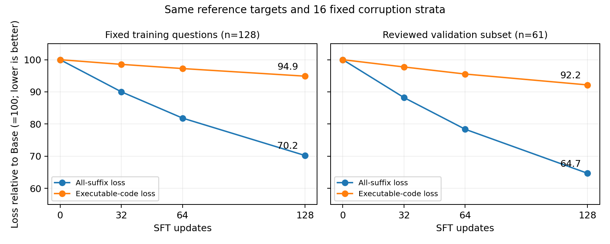

# 给讨论此项目的 AI：完整上下文

## 任务与阅读口径

我们希望一个约168M参数的TinyGSM预训练MDLM，把英文小学数学应用题转换为可执行Python函数，通过隔离执行返回正确数值。核心目标是获得SFT实际解题收益，而非仅降低loss。最近也单独研究推理采样能否改善Base。

请区分训练收益、推理收益、训练题拟合、开发集调参和独立确认；不要因实验完成就说模型提分成功。下文来自已完成实验报告，未提供完整逐题原件，读者可以评议结论但不能仅凭本公开仓库独立复算所有分数。

## 最新状态提示

独立推导辅助多任务SFT已完成：新384题两种子均高于Base及普通32/64步，均值42.58%；但主要97.5%配对区间跨零，属于初步正向信号。下面保留各阶段历史结果，最新详见末尾“独立推导辅助多任务SFT”更新，不要将旧阴性结论概括为本轮没有方向性收益，也不要宣布本轮已经稳定提分。

## 当前最重要的判断

1. 后续多项SFT尝试没有形成稳定超过Base的证据；不能说训练根本没更新，也未找出唯一失败原因。
2. Base加ReMDM固定5%回改已完成新512题确认：33.50%→37.60%，+4.10个百分点，按题配对95%区间[+2.44,+5.76]；支持在该协议下保留为优先推理候选。
3. 新512题确认已全部完成，没有继续调参数或自动追加实验。早先128题确认区间跨0的记录保留为历史结果。
4. 最新注释SFT在另一新512题上没有超过Base或普通SFT；详见后续更新。SFT与ReMDM尚不能混报：已有同采样的Base/SFT对照，尚未得到稳定的额外SFT收益；旧模型和最新32步模型结果见最新更新。

## 模型与生成机制

使用发布EMA的TinyGSM MDLM checkpoint，来源为 `jdeschena/s-flm` 发布库中的离散MDLM基线，**不是该库的球面流模型，也不是Dream7B**。问题前缀固定；分隔符是字面量反斜杠+n。

常规SFT随机采样遮盖程度，对参考程序加MASK并预测；并非训练时逐题展开128步生成。原生成从答案全MASK开始，逐步接受token，非固定左到右；标准吸收态采样中已接受token不再改动。多轮预测未确定位置不等于能修改已确定位置。

ReMDM可让已接受token回到MASK，再在后续前向重选。模型权重不变，变的是采样转移。作为当前基线的ReMDM实现按概率回遮，没有错误检测器或标准答案引导；另有联合SFT学习评分回改实验，结果见最新更新。

## 数据与评估共同限制

- dev384是GSM8K训练部分的固定划分，长期用于开发，已重复使用。
- 原最终test1319曾完成正式评测，此后锁定，不重新用于选方案。
- 原SFT来自TinyGSM；后续512和128训练实验来自隔离于dev的GSM8K训练池。
- 备用确认题排除已知实验使用ID，但不能证明Base预训练没见过。
- 通常生成128步、温度0.1、micro4、固定题序。种子42/123是生成随机种子；多数训练仍只有一个训练种子。
- 生成按批次位置派生随机种子；换子集/批次会改变同题噪声，必须固定批次或重新评估匹配Base。
- 数值正确不保证解题语义正确；执行率、语法率、token恢复率不能代替最终正确率。

## SFT 证据全览

## 任务与原始实验

任务为英文小学数学应用题→Python函数→隔离执行→比较返回数值。模型为约168M参数、TinyGSM预训练MDLM，从发布EMA权重开始；不是Dream7B。原开发集384题取自GSM8K训练部分，原始SFT数据来自TinyGSM。

最初Base全错由输入分隔符不匹配造成：原生协议要求字面量反斜杠+n（Python `r"\n"`，token IDs 76、94），不是实际换行。修复后检查tokenizer、EMA及原生输出一致性，Base开发集seed42达到146/384。它不是训练收益。

原始random与filtered是两次独立SFT，各4096条TinyGSM、3个epoch、192次更新、lr2e-5；filtered强调执行过滤，不代表全量语义审核。dev最佳分别151/384与153/384。RL main使用1024条GSM8K训练池，256个outer step、492次参数更新，选第192个outer step。

| 原始最终测试（1319题） | 正确题数 | 正确率 |
| --- | ---: | ---: |
| Base | 423 | 32.07% |
| SFT random | 430 | 32.60% |
| SFT filtered | 424 | 32.15% |
| RL main | 415 | 31.46% |

原始测试已使用并锁定，后续没有再次使用它选方案。不能把下面开发集成绩与这张表直接相减。

## 后续训练对照

通常固定Base起点、有效batch16、micro4；原生监督含code/docstring/EOS/PAD，prompt不参与损失。生成128步、温度0.1、固定题序。除明确注明外，下面开发分数仅seed42。

| 实验 | 训练改动 | dev384 |
| --- | --- | ---: |
| SFT64 | 64条经过用户数学复核的TinyGSM，lr2e-5，128更新 | 131/384 |
| SFT16原命名 | 同16题，原代码，lr2e-5，128更新 | 126/384 |
| SFT16规范命名 | 相同题目，仅局部变量改名，保持运算 | 130/384 |
| SFT16高遮盖 | 原命名，约60%训练展示的遮盖概率≥80% | 140/384 |
| GSM512，lr5e-6 | 512条参考算术编译程序，第64/128更新 | 141/384、130/384 |
| GSM512，lr2e-5 | 同512条，第64/128更新 | 117/384、97/384 |

SFT64的训练题生成为38/64→第64步40/64→第128步39/64；训练集小幅变化不能作泛化证据。命名与高遮盖实验降低了部分NameError或提高单步恢复，未整体超过Base。

GSM512来源为既有1024条GSM8K训练池：验证参考答案的算术标注、依赖连通、最终数值和隔离执行，筛得556条后固定抽512条。程序是规则编译的参考式，不是强教师新生成；全部机器核验，非全部人工语义审核。

| 完整dev384，两个生成种子 | seed42 | seed123 | 均值 |
| --- | ---: | ---: | ---: |
| Base | 146 | 142 | 37.50% |
| GSM512 lr5e-6，第64步 | 141 | 136 | 36.07% |
| 同512条，docstring直接损失权重0 | 141 | 139 | 36.46% |
| 同128题，参考编译程序SFT | 143 | 140 | 36.85% |
| 同128题，Base正确生成程序SFT | 145 | 138 | 36.85% |

原GSM512候选按seed42选择第64步，再复核seed123。其相对Base平均−1.43个百分点，按题配对bootstrap95%区间[−3.26,+0.52]；不能称低学习率已证明稳定退化。

docstring权重0保持文本、遮盖、损失分母及其他token权重不变，预定64更新。对原SFT均值+0.39个百分点，区间[−1.04,+1.82]；对Base−1.04，区间[−3.12,+0.91]。未获得明确收益。

128题答案来源对照先让Base在512题生成，经执行/接口/依赖/长度/题目一致性和语义风险过滤后190条合格，固定抽128条，两臂相同题目及顺序；lr5e-6、64更新（8遍）、原生目标。最终集合Agent抽审32题，非全量人工审核。两臂均值相同，其差值区间约[−2.08,+2.08]个百分点；不能证明两种监督等效。未达到预定+2个百分点且两种子均提高门槛，未触发第三次训练及换训练种子复现。该阶段已结束。

## 训练题与固定噪声诊断

固定随机抽取GSM512训练题64条，分别重跑两种子；这是训练子集，不是独立验证集。

| 模型 | seed42 | seed123 | 均值 |
| --- | ---: | ---: | ---: |
| Base | 24/64 | 30/64 | 42.19% |
| lr5e-6，第64步 | 25/64 | 26/64 | 39.84% |
| lr2e-5，第128步 | 15/64 | 21/64 | 28.12% |

不支持“训练题已经学好，只是不能泛化”。后两者同时改变学习率和步数，不能单独识别学习率效应。较强更新两个种子都明显下降；低学习率方向不一致。

在相同64题、固定噪声下，原生总loss为0.4011→0.2862/0.1745，实际计算代码loss为1.2341→1.1868/1.0026。重复题目docstring贡献总loss下降的93.62%/84.32%；它是数值分解，不是梯度或因果归因。

100%遮盖实际代码单步top1恢复率仅25.55%→25.67%/25.87%。原生加权loss、masked-only NLL、token恢复率、完整程序正确率是不同指标。参数更新与梯度核验已通过，不应再假定训练完全没生效。

额外语义审查发现参考语义歧义、常量碰巧同值导致依赖缺失、变量名含义不清等风险；机器数值正确不等于推理正确。审查不是完整数据认证，亦没有证明这些风险是训练退化的唯一原因。

## 生成轨迹与结论边界

对既有10个错误案例涉及的8个原始批次进行三模型重放，96份输出逐字复现；3072次步进检查中已提交非MASK位置改写为0。错误可能早出现，也可能晚出现。核验确认原采样不能回改，但没有证明它导致SFT相对Base的分差。

现有尝试没有找到稳定优于Base的SFT。没有足够证据确定唯一根因，也不能否定所有SFT、教师数据、自训练、LoRA或RL方案。多个生成种子是同题重复，不是独立训练；反复使用的开发集存在选择偏差。

## ReMDM 证据全览

固定原Base，不进行训练。使用ReMDM论文Eq.6–7及cap/switch策略的本地适配；不是论文全部配置复现。

前半程沿用原采样；噪声时间t≤0.5后，已可见生成位置以最高单步5%概率回到MASK，后续前向才可重新预测；题目固定，末步禁止回遮并完成剩余填空。回遮同时调整MASK显露概率，不能只随意擦除token。

设alpha_t为当前保留率、alpha_s为下一步保留率：

```text
rho = min(eta, 1, (1-alpha_s)/alpha_t)
P(visible -> MASK) = rho
P(MASK -> token) = (alpha_s-(1-rho)*alpha_t)/(1-alpha_t)
```

回遮未必更换成不同token，也可能损害正确内容。本次没有按答案或置信度挑回改位置，没有投票，每题一个候选。

## 筛选与完整开发评估

原dev384按原四题批次固定抽96题，保留批次位置派生的随机种子。比较原采样、cap0.01、cap0.05；均128次模型前向、温度0.1、micro4、长度512、生成种子42/123。

| 96题探索 | seed42 | seed123 | 均值 |
| --- | ---: | ---: | ---: |
| 原采样 | 41 | 31 | 37.50% |
| cap0.01 | 42 | 34 | 39.58% |
| cap0.05 | 44 | 37 | 42.19% |

依预设规则选cap0.05并补充其余288题，未再次调参数。

| 集合 | 原采样seed42/123 | 回改seed42/123 | 均值变化 | 按题配对95%区间（百分点） |
| --- | --- | --- | --- | --- |
| 全dev384 | 146/142 | 160/151 | 37.50%→40.49%，+2.99pp | [+1.17,+4.82] |
| 未参与本轮选择的288题 | 105/111 | 116/114 | 37.50%→39.93%，+2.43pp | [+0.35,+4.69] |
| 备用确认128题 | 39/35 | 42/36 | 28.91%→30.47%，+1.56pp | [−1.56,+5.08] |

开发集包含候选选择且此前重复使用，区间未校正选择。确认128题是在固定候选后才评估，但区间跨0，不能宣布稳定提分。确认题来自排除已有实验登记ID的GSM8K训练缓存，不保证Base预训练未见；不能称为严格预训练未见题。确认集已经使用，后续不可再称从未评估。

按题bootstrap保留同题两个生成种子，10000次。两种子不是两倍独立题，也不衡量多训练种子波动。

## 错误、开销与验证

全dev384两种子共768次判分：正确288→311；执行/解析/非数值等失败177→110；可执行数值错误303→347。失败减少不全转成正确，不能只看执行率宣布数学推理提高。

cap0.05在同96题生成耗时约增加7%，确认128题约增加7%–8%；每题均128次前向，额外开销来自转移和统计。全部占卡作业约23.38分钟，不是平台总计费时间。

8项CPU检查通过；eta0与原生采样一致；96题原采样与既有响应逐字一致；逐批核验前向次数、提示词不变、末尾无MASK、回遮有后续显露、Base权重哈希不变。回遮事件涵盖EOS/PAD，不能当作代码错误修复次数。

第一轮当时的结论：128题确认尚不足以认定稳定收益；后续512题完成后证据增强，见下节。两轮都不是SFT收益。

## 扩大确认：新512题已完成

固定上一轮cap0.05、switch0.5，未重新调参，全部512题在两方法、两个生成种子下重新生成。模型仍为同一Base，128次前向、温度0.1、micro4、长度512，没有训练，也未评估SFT权重。

| 方法 | seed42 | seed123 | 平均正确率 |
| --- | ---: | ---: | ---: |
| 原采样 | 170/512 | 173/512 | 33.50% |
| 固定5%回改 | 192/512 | 193/512 | 37.60% |

平均提升4.10个百分点，按题配对bootstrap95%区间[+2.44,+5.76]个百分点。seed42修复29题、退化7题，净增22；seed123修复31题、退化11题，净增20。两个种子均提高，区间排除0，支持该配置在本轮协议和样本范围内有正向收益，保留为当前优先推理候选。

本轮在生成前冻结样本：核对63份非test历史输入，排除已盘点训练/开发/RL/评估题及上一轮确认128题，从5937题中固定种子20261110随机抽512题并按源顺序排列；最终test仅用既有登记ID排除，不读取其题目或预测。隔离使用NFKC、大小写和空白规范化后的题目哈希，不保证排除语义改写，也不证明Base预训练未见。这512题现在已使用，不能再称未评估。

两个生成种子是同512题的重复，不是1024道独立题。配对区间按题重采样10000次，保留同题两个种子；只支持当前模型、数据和协议的结论，不是所有任务/模型上的普遍保证。不同题集应比较各自同题对照的提升，不能将37.60%与旧开发集40.49%直接比较优劣。

相同128次前向下，原采样生成724.1秒、回改776.7秒，增加约7.3%；按批轮换运行顺序以减少计时偏差。全部作业墙钟约27.25分钟，含加载、预检和评分。两种子合计正确343→385、执行/解析/非数值失败231→141、可执行数值错450→498；执行率改善不能全部解释成推理正确。

审计核对2048份预测、512个批次各128次前向、提示词保护、无最终MASK、eta0与原生一致及82个冻结输入哈希不变。没有按中途成绩早停或改变参数，没有新增模型文件。实验已结束，未安排后续任务。

这验证的是**Base的采样收益**，不能称SFT成功；尚未完成Base/SFT各自配原采样/ReMDM的匹配对照。

论文：[Remasking Discrete Diffusion Models with Inference-Time Scaling](https://arxiv.org/abs/2503.00307)。

## 补充：只增加生成步数没有稳定收益

先前96题实验512步明显优于128步，但放到固定完整dev384后：128步146/142题，均值37.50%；512步141/149题，均值37.76%，耗时3.74倍。不同子集批次改变噪声，小样本积极结果不可直接推广。当前ReMDM比较保持128次前向。

## 更新：最新SFT对照、学习曲线与代码loss诊断

本页补齐此前公开版之后的实验。全部使用约168M参数同一Base，核心结果仍是：固定ReMDM回改有推理收益，尚未找到稳定的额外SFT收益。

## 1. 固定采样下检查训练增益

先前GSM512低学习率step64在dev384做完整2×2对照：

| 模型与采样 | seed42 | seed123 | 平均正确率 |
| --- | ---: | ---: | ---: |
| Base＋原采样 | 146 | 142 | 37.50% |
| 旧SFT＋原采样 | 141 | 136 | 36.07% |
| Base＋固定ReMDM | 160 | 151 | 40.49% |
| 旧SFT＋固定ReMDM | 156 | 149 | 39.71% |

回改对该SFT也有效（+3.65个百分点），但同回改下SFT相对Base−0.78个百分点、95%配对区间[−2.86,+1.30]；没有额外训练收益证据。不能把SFT＋回改超过原采样Base算作SFT收益。

随后在相同128条审阅参考程序上，主干lr2e-6、effective16/micro4、warmup4、32次更新（4遍）、训练seed42，从Base分别训练匹配普通SFT、联合错误上下文/位置评分头SFT，以及LIFT-3适配。主干全参数更新，评估最终step32。

| 方法 | dev384 seed42 | seed123 | 平均正确率 |
| --- | ---: | ---: | ---: |
| Base＋固定ReMDM | 160 | 151 | 40.49% |
| 普通SFT＋固定ReMDM | 159 | 154 | 40.76% |
| 联合SFT＋固定ReMDM | 160 | 153 | 40.76% |
| 联合SFT＋学习评分回改 | 148 | 142 | 37.76% |
| LIFT SFT＋固定ReMDM | 160 | 150 | 40.36% |

联合组50%普通输入、50%错误上下文输入，加入位置BCE；小型位置头98,561参数。人工单token运算符扰动不代表真实错误分布。固定采样下与普通组差值0.00个百分点、区间[−0.91,+0.91]；同联合模型改用学习评分回改后−2.99个百分点、区间[−5.08,−0.91]。改值次数更多不等于修复更多错误。

LIFT先用无梯度前向估计参考token概率，再按遮盖阶段选困难/随机/容易位置回填监督；适配官方LIFT-3，不是新评分头。对Base−0.13个百分点、区间[−1.56,+1.30]，对普通组−0.39、区间[−1.56,+0.78]。LIFT多一次无梯度前向，等更新数不等于等训练算力。

单一配方的阴性结果不能否定论文完整方法或全部SFT。dev已重复使用；所有区间按题保留两个生成种子，未覆盖多训练种子波动或校正反复选型。

## 2. 普通SFT继续到64/128步

从上述普通组的完整step32状态恢复，沿同一优化器与学习率轨迹继续到step128；lr2e-6，原生遮盖目标，固定ReMDM生成。最初重跑轨迹校验因小幅梯度范数差异停止，随后通过核对旧step32状态恢复；没有声称重新跑出的轨迹逐位相同。

| 累计更新 | 数据遍数 | 训练128题均值 | dev384均值 |
| --- | ---: | ---: | ---: |
| Base | 0 | 63.28% | 40.49% |
| 32 | 4 | 64.06% | 40.76% |
| 64 | 8 | 64.84% | 40.36% |
| 128 | 16 | 66.41% | 39.84% |

128步相对Base，训练题+3.12个百分点、区间[−0.78,+7.03]；dev−0.65、区间[−2.73,+1.43]。训练题点估计上升但区间跨0，dev没有同步收益；不能仅凭曲线确诊过拟合。

## 3. 最新诊断：训练与验证代码loss都下降

这次仅前向，不训练、不新增完整生成。原训练128题；先冻结dev前64题，Agent编写参考代码并检查算术/依赖/隔离执行，排除3个歧义或参考错误题且不补位，得到验证61题。参考程序在读取生成成绩前冻结；未写回训练。不是独立人工认证，也不是独立最终测试。

四个检查点使用eval模式、相同16组分层时间/遮盖条件，代码区域排除题目复述docstring、注释、纯空白、EOS/PAD。代码loss采用原MDLM的1/t加权，分母为该区域所有可监督token。

| 检查点 | 训练总loss | 训练代码loss | 验证总loss | 验证代码loss | 同61验证题生成均值 |
| --- | ---: | ---: | ---: | ---: | ---: |
| Base | 0.392700 | 1.136295 | 0.365134 | 0.556284 | 45.90% |
| 32 | 0.353518 | 1.119849 | 0.322112 | 0.543694 | 47.54% |
| 64 | 0.321434 | 1.104991 | 0.286194 | 0.531476 | 45.08% |
| 128 | 0.275836 | 1.078217 | 0.236216 | 0.512672 | 44.26% |

Base→128步，训练代码loss下降5.11%、验证下降7.84%；配对变化区间分别[−0.063974,−0.052483]与[−0.053581,−0.034437]，均低于0。这说明参考代码补全改善并不限于训练题，本诊断没有出现验证代码loss上升。

同61题生成从45.90%到44.26%，差−1.64个百分点、区间[−6.56,+3.28]，既无收益证据，也未证明显著退化。61题是dev子集，不可拿其绝对分数替代dev384。

总loss减少量中，docstring贡献训练侧93.54%、验证侧96.01%；可执行代码贡献5.82%、3.26%；PAD贡献0.12%、0.22%。这是损失值分解，不是梯度归因，更不是“删除docstring一定提分”的证据；已有取消docstring损失消融没有稳定收益。

更准确的结论是：**固定参考代码和遮盖上下文下的补全能力提高，尚未转化为完整生成任务收益。** 单参考程序不覆盖所有正确解法，部分正确上下文也不同于从全MASK生成并继承自身错误；这些是解释边界，不是唯一根因证明。

总loss与代码loss分母不同；训练与验证参考程序风格也不同。比较各集合内部的变化，不用训练/验证绝对loss高低给难度或泛化排名。

3072次主干前向、12096条逐题遮盖记录与分区损失加总检查通过；模型与原数据哈希未变。无新增训练、生成或模型文件。诊断约1.48分钟。

详见[完整loss报告](reports/CODE-VAL-LOSS.zh-CN.md)。



曲线以各自Base归一化为100。现阶段继续保留Base＋固定ReMDM为参照，不仅凭loss下降继续加训练步数。

## 更新：256步、注释监督与新512题留出复核

截至2026-11-03，以下实验均已完成；没有因本次同步启动新任务。原Base＋固定5% ReMDM仍是当前参照方案，尚未找到稳定的额外SFT收益。

## 1. 256步扩展：代码loss继续下降，解题收益仍未出现

从旧128步权重继续更新128次，主干lr2e-6保持恒定，但**在128步处按事先决定重置Adam优化器**。不是沿旧优化器无缝续训，不能把结果作为纯训练步数因果。

| 检查点 | 训练128题均值 | dev384均值 | 验证61题代码loss |
| --- | ---: | ---: | ---: |
| Base | 63.28% | 40.49% | 0.556284 |
| 32步 | 64.06% | 40.76% | 0.543694 |
| 64步 | 64.84% | 40.36% | 0.531476 |
| 128步 | 66.41% | 39.84% | 0.512672 |
| 256步，128处重置优化器 | 64.06% | 39.71% | 0.480970 |

相对128步，训练代码loss继续下降4.61%，验证代码loss下降6.18%；固定参考与遮盖上的补全目标改善，但完整生成没有同步提升。dev差−0.13个百分点、按题配对95%区间[−2.34,+2.08]，不能宣称稳定退化或收益。

全部生成使用相同ReMDM eta0.05、switch0.5、128次前向、温度0.1、micro4、两个生成种子。详见[256步报告](reports/SFT-STEP256.zh-CN.md)。

## 2. 注释版SFT：同题同程序，仅增加计算依据注释

同一128条GSM8K来源训练程序，新增327条英文短注释，说明数量关系、运算依据与单位换算。移除新增注释后逐字符还原旧代码，完整AST一致，题目、gold、变量、算式和函数接口未改；两版隔离执行均通过。由Agent审阅，不是独立人工认证。

从同一Base开始，lr2e-6、warmup4后恒定、effective16/micro4，连续128次更新（16遍），没有中途重置优化器。普通SFT不使用旧position_weights辅助元数据，因此不能把其中0.1解释为注释token损失仅十分之一。

新增注释改变了非PAD监督、token位置与格式；相同随机种子不保证相同代码token遮盖，属于注释监督整体方案，不能单独识别解释语义的因果效应。随机遮盖总训练loss也不能直接跨两种目标长度比较。

预先规定：dev384 seed42在32/64/128步选最高，平局选早；无论是否超过Base，都复核选中点seed123和训练题双种子。分数166/160/163，选中32步；未选中检查点不虚构seed123结果。

| 模型，固定ReMDM | dev seed42 | dev seed123 | dev均值 | 训练128题均值 |
| --- | ---: | ---: | ---: | ---: |
| Base | 160/384 | 151/384 | 40.49% | 63.28% |
| 原代码普通SFT32步 | 159/384 | 154/384 | 40.76% | 64.06% |
| 注释SFT32步 | 166/384 | 151/384 | 41.28% | 64.45% |

注释版相对Base平均+0.78个百分点，95%区间[−0.78,+2.34]；相对普通版+0.52，区间[−0.78,+1.82]。seed42参与选点，seed123只是同题新生成随机性，不能作为独立新题验证。详见[注释SFT报告](reports/SFT-COMMENTS128.zh-CN.md)。

## 3. 新512题留出：旧开发集的小幅优势没有复现

固定选中的注释step32与同一步普通SFT，再与Base比较，三个模型、两个生成种子使用完全相同的ReMDM与生成预算；本轮仅推理，不再选点、调参或训练。

| 模型 | seed42 | seed123 | 平均正确率 |
| --- | ---: | ---: | ---: |
| Base | 215/512 | 210/512 | 41.50% |
| 原代码普通SFT32步 | 217/512 | 200/512 | 40.72% |
| 注释SFT32步 | 216/512 | 201/512 | 40.72% |

| 配对比较 | 均值差/百分点 | 95%区间 | 97.5%区间 |
| --- | ---: | --- | --- |
| 注释SFT − Base | −0.78 | [−2.05,+0.39] | [−2.25,+0.59] |
| 注释SFT − 普通SFT | +0.00 | [−0.88,+0.88] | [−0.98,+0.98] |
| 普通SFT − Base，次要比较 | −0.78 | [−1.95,+0.39] | [−2.15,+0.49] |

按题配对bootstrap20000次，保留同题两个生成种子及三个模型，不当成1024道独立题。两个主要比较另用各97.5%区间近似作Bonferroni族错误率控制；区间仍不覆盖不同训练种子波动。均值相等不证明两种监督等效，区间跨0不等于证明任何效应都不存在。

本轮从GSM8K train的7473题中，盘点1774份历史记录，排除2048道已记录题及3道数字模板重合题，从5422题中固定随机抽512，生成前冻结。隔离相对于可查本地项目记录，不保证Base预训练未见或语义完全去重；不是官方test。此512题与先前ReMDM收益确认512题是不同集合，已排除后者。

这批512题现在也已被评估，不能继续调模型后再称其独立未见。跨集合不比较绝对正确率；依据同题配对差值判断。

本轮不支持这套注释配方的提分结论，也没有证明所有SFT或注释监督无效。详见[512题完整留出报告](reports/SFT-COMMENTS-HOLDOUT512.zh-CN.md)。

## 4. 对后续判断的影响

- 原先“训练和验证代码loss下降，但任务收益没有同步提高”的结论得到256步结果补充；没有出现验证代码loss恶化的证据。
- 注释监督在旧dev的点估计优势没有在新留出集上复现，不能以旧dev最高分宣布方案成功。
- ReMDM早先在另一512题上的+4.10个百分点，是Base采样策略收益；这里的SFT比较三个模型都已使用同一ReMDM，不能混记训练收益。
- 本公开仓库仍只发布聚合报告与方法上下文。详细数据、逐题结果、失败恢复记录、冻结计划和日志在私有归档；模型权重不上传GitHub。

## 更新：独立推导辅助多任务SFT

**出现方向一致的初步正向信号，值得保留并复核；尚未确认稳定收益。** 本轮辅助SFT在新384题的两个生成种子上都超过Base、普通32步和普通64步对照，但两个主要97.5%配对区间都跨零。不是宣布此前SFT收益问题已经解决。

## 改动：把推导作为独立辅助任务

同一128道GSM8K来源训练题构成两个任务，共享原约168M MDLM全主干：

| 任务 | 输入 | 训练目标 | 最终评测 |
| --- | --- | --- | --- |
| 代码主任务 | 原题目及原分隔符 | 原Python程序 | 只执行这一任务 |
| 推导辅助任务 | 解释标识＋题目及分隔符 | 整理后的自然语言参考推导 | 不生成解释，不拼回输入 |

与上一轮“给代码插注释”不同，本轮原代码目标保持不变，推导单独编码。推导不是代码任务始终可见的条件，代码评测仍然只给题目；没有两阶段推理或额外生成预算。

参考推导来自原128训练题的gold_answer，去除GSM行内标记及最终答案行，Agent逐题审阅并记录10处文字/单位修正；没有新教师模型，也没有使用评测题构造辅助内容。Agent审阅不是独立人工认证。

## 配方与匹配对照

从同一Base开始，训练32次AdamW更新；主干lr2e-6、warmup4后恒定、effective16/micro4、训练seed42。每步16条代码任务及同题16条解释任务，各任务共512次展示，即各4遍。仅训练一个候选，没有按新题集挑步数或辅助权重。

```text
L = L_code + 0.5 × L_rationale
```

两支各按自身监督token数归一化，使用MDLM原生1/t加权MASK恢复。代码支题序、学习率、分母和遮盖输入哈希与旧普通32步逐项匹配，包含EOS/PAD；辅助支只遮盖和监督正文/EOS，PAD保持可见且不计loss；随机流隔离，避免推进代码任务的后续噪声流。

本轮总训练前向256次，约为普通32步两倍。普通32步匹配代码曝光与更新次数；普通64步也有256次前向，但64次更新、1024次代码曝光。因此64步只是计算量补充对照，不能称所有变量同时匹配。普通两模型是既有检查点，不是本轮并行重新训练。

借鉴[Distilling Step-by-Step](https://aclanthology.org/2023.findings-acl.507.pdf)的标签/推导双任务与分别前向组合损失；原论文使用T5，本轮适配为MDLM代码/解释恢复。辅助权重0.5、PAD处理及任务标识是本轮预设适配，不是论文完整复现。

## 新384题结果

**这是新留出384题，绝不是原来反复使用的dev384。** 从盘点历史使用记录后剩余4910题中固定随机抽样；题目ID、规范化文本和数字模板均未命中项目历史输入，且排除了此前注释SFT确认512题。不是官方test，也不能保证Base预训练未见或语义完全去重。

四模型固定相同ReMDM eta0.05、switch0.5、128次前向、温度0.1、batch4、总长度512，两个生成种子42/123，同批次题序及评分器。

| 模型 | seed42 | seed123 | 两种子均值 |
| --- | ---: | ---: | ---: |
| Base | 153/384 | 169/384 | 41.93% |
| 普通SFT32步，同代码曝光 | 155/384 | 163/384 | 41.41% |
| 普通SFT64步，同前向次数 | 151/384 | 170/384 | 41.80% |
| 独立推导辅助SFT32步 | 156/384 | 171/384 | 42.58% |

| 配对比较 | 差值/百分点 | 95%区间 | 97.5%区间 | 两种子净增 |
| --- | ---: | --- | --- | --- |
| 辅助SFT − Base，主要 | +0.65 | [−0.78,+2.08] | [−1.04,+2.34] | +3、+2 |
| 辅助SFT − 普通32步，主要 | +1.17 | [+0.00,+2.34] | [−0.13,+2.47] | +1、+8 |
| 辅助SFT − 普通64步，次要 | +0.78 | [−0.78,+2.34] | [−1.04,+2.60] | +5、+1 |

按384题配对bootstrap20000次，同题四模型及两个种子一起保留。两个主要比较各给97.5%区间，近似Bonferroni族95%；95%为描述性区间。“对普通32步的95%下界+0.00”经过四舍五入，不能据此越过主要97.5%区间跨零的结论。

单一训练种子和同题两个生成种子不足以确认跨训练稳定性。新题集使用后也不能再次声称未参与选型；若据此改变方案，需要新的验证安排。绝对正确率不能与旧dev384或前512题直接比高低。

## 意义与尚未证明的部分

本轮提供了训练改动方向一致的正向信号：代码任务保持原协议，辅助文本以独立任务参与训练，测试仍只生成代码。收益来自模型训练方案及其波动，不是新增采样预算。

它同时改变辅助文本、任务条件、训练计算量和辅助PAD处理，尚不能单独定位是哪一项发挥作用，也不能把区间跨零称为已确证收益。此前注释监督的留出阴性结果仍保留，不应用本轮覆盖历史负结果。

下一步若继续，应先固定候选进行复核，必要时换训练种子；先报告不确定性，再决定是否扩大训练。当前尚未自动追加实验。

## 核验与资源

两支均有非零主干梯度；代码支遮盖哈希及旧缓存重放一致；全部768个新评测批次均128次前向、前缀不变、最终无MASK。初始逐元素梯度叠加预检失败发生在零次正式更新时，随后记录BF16误差与方向一致性并采用数值容差检查；不宣称GPU梯度逐位一致。

仅一组正式训练，新增3072份代码生成，占卡任务进程累计47.82分钟（含失败预检与诊断），未安排后续任务。随机遮盖代码loss与辅助loss属于不同目标，不直接按绝对值比较能力；本轮没有新增验证代码loss评测。

完整聚合报告：[RATIONALE-MULTITASK128.zh-CN.md](reports/RATIONALE-MULTITASK128.zh-CN.md)。原始数据、逐题响应、代码、冻结协议和审计在私有归档；权重未上传GitHub。

## 希望进一步讨论的问题

- 512题确认已为正且区间不跨0，如何进一步检验跨任务/模型的适用范围，避免继续在已用确认集上调参？
- 已有相同采样下Base/SFT对照且未见稳定收益；下一步怎样设计单一训练干预，检验参考补全改善为何未转成完整生成收益？
- 是否有能够针对“去噪目标改善但完整生成不改善”的训练干预？请给出明确假设、最小对照、停止条件和资源估计，区分文献证据与猜测。
- 若建议教师程序、LoRA、RL、轨迹训练或更大模型，请说明本项目证据为什么支持优先尝试，不要把尚未验证的方法写成必然有效。

本页不授权阅读者自行启动后续实验。公开文件不包含凭据、服务器访问或模型权重。
