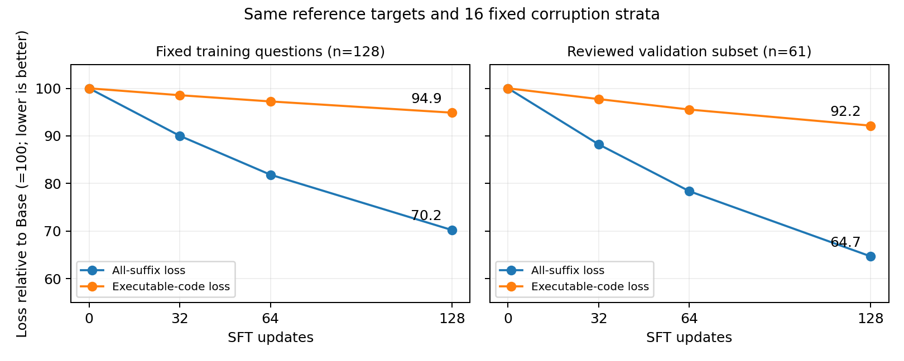

# 固定遮盖下的代码训练/验证损失诊断

**补测更支持“参考代码补全能力改善，尚未转化为完整生成收益”。训练和验证的代码loss均下降，本轮没有出现验证代码loss上升的过拟合信号。总loss降幅主要来自题目复述docstring；代码也有可检验的改善，但幅度明显较小。**

原训练128题与固定验证61题，Base及32/64/128步四个检查点；16组分层时间/遮盖条件逐题固定，eval+inference_mode，仅前向。没有训练、反传、优化器更新或新生成评测。

## 主要结果

| 检查点 | 训练总loss | 训练代码loss | 验证总loss | 验证代码loss |
|---|---:|---:|---:|---:|
| Base | 0.392700 | 1.136295 | 0.365134 | 0.556284 |
| 32步 | 0.353518 | 1.119849 | 0.322112 | 0.543694 |
| 64步 | 0.321434 | 1.104991 | 0.286194 | 0.531476 |
| 128步 | 0.275836 | 1.078217 | 0.236216 | 0.512672 |

表中代码loss仅统计变量、数值、运算符、语法等代码token，排除题目复述docstring、注释、纯空白、EOS/PAD；采用原MDLM的1/t加权，分母是该区域所有可监督token（不是只数本次MASK）。总loss使用原完整后缀分母。两种指标分母不同，不能直接按数值大小比较。

训练列同样采用eval模式和固定遮盖；不是先前训练日志中不同批次、不同随机遮盖的loss。训练/验证参考代码风格不同，重点比较每个集合内部随检查点的变化，不比较两集合绝对高低。

## 相对Base的代码loss变化

| 检查点 | 训练代码Δ | 训练95%区间 | 验证代码Δ | 验证95%区间 |
|---|---:|---|---:|---|
| 32 | -0.016446 | [-0.018230, -0.014752] | -0.012590 | [-0.015662, -0.009779] |
| 64 | -0.031304 | [-0.034657, -0.028152] | -0.024808 | [-0.030543, -0.019542] |
| 128 | -0.058078 | [-0.063974, -0.052483] | -0.043612 | [-0.053581, -0.034437] |

按题配对重采样10000次，每题的16组遮盖一起保留；区间以这些固定参考程序和噪声为条件，不覆盖其他合法解法或独立训练种子的变动。

## 总loss下降来自哪里

| 分区 | 训练Base贡献 | 训练128步贡献 | 验证Base贡献 | 验证128步贡献 |
|---|---:|---:|---:|---:|
| executable | 0.132963 | 0.126167 | 0.053635 | 0.049430 |
| docstring | 0.246871 | 0.137554 | 0.294204 | 0.170427 |
| comment | 0.000000 | 0.000000 | 0.000000 | 0.000000 |
| whitespace | 0.008406 | 0.007809 | 0.007960 | 0.007333 |
| eos | 0.000997 | 0.000978 | 0.001392 | 0.001361 |
| pad | 0.003463 | 0.003328 | 0.007943 | 0.007665 |

本表所有分区使用同一个完整后缀分母，贡献可相加得到总loss；这是损失值分解，不是梯度贡献测量。

## 不同遮盖阶段的代码恢复

| 集合 | 遮盖阶段 | Base代码MASK平均NLL | 128步代码MASK平均NLL |
|---|---|---:|---:|
| train | low | 0.188882 | 0.182806 |
| train | middle | 0.810965 | 0.762898 |
| train | high | 3.067567 | 2.918175 |
| validation | low | 0.038107 | 0.037396 |
| validation | middle | 0.205500 | 0.184386 |
| validation | high | 1.951680 | 1.808937 |

low/middle/high分别为16个时间分层中的前4、中8、后4层，约对应遮盖概率0–25%、25–75%、75–100%；本表是被MASK代码token的未加权NLL，与上面的原目标加权loss不同。没有额外100%遮盖评测。

## 同一批题的完整生成成绩（复用已有结果）

| 检查点 | 训练128题两种子均值 | 验证61题两种子均值 |
|---|---:|---:|
| Base | 63.28% | 45.90% |
| 32 | 64.06% | 47.54% |
| 64 | 64.84% | 45.08% |
| 128 | 66.41% | 44.26% |

这些成绩从此前固定ReMDM、seed42/123的逐题预测中取同一批ID；没有新增完整生成。61题子集不等于原dev384，不能把其分数当作整套开发集结果。参考程序先冻结再读取这些预测，未用预测结果选择或编写代码。

## 结果意味着什么

1. **代码补全改善并不限于训练题。** Base到128步，训练代码loss下降5.11%，验证代码loss下降7.84%；相对Base的配对区间均低于0。在本61题、这组参考程序及固定遮盖条件下，代码补全改善并不限于训练题。此前仅凭完整生成曲线偏向泛化受损的解释需要收窄：本轮没有发现补全目标的验证loss恶化。
2. **总loss改善主要来自docstring，但代码也有改善。** 总loss下降中，题目复述docstring贡献训练侧93.54%、验证侧96.01%；可执行代码贡献5.82%、3.26%；PAD仅贡献0.12%、0.22%。这是损失值的来源，不等于梯度贡献或因果归因，不能直接推出“删docstring/PAD就能提分”。
3. **完整生成收益仍未得到支持。** 同61题的固定ReMDM生成均值从45.90%变为44.26%，差值-1.64个百分点，配对95%区间[-6.56,+3.28]。这不是已证明的显著退化，但没有同步提高的证据；原dev384也未测到训练收益。

下一步若继续实验，应围绕“代码补全改善为何没有转化成最终程序正确率”提出单一、可对照的改动；不再仅凭总loss下降决定增加步数。文档权重的损失分解可作为线索，但需结合已有相关消融，不能把本轮当作降低文档权重必然有效的证明。尚未启动额外实验。

图中每条曲线以自身Base数值归一化为100，只比较变化幅度，不把训练和验证的绝对loss混为同一难度尺度。

## 参考程序与限制

原dev384没有Python参考程序。本轮先冻结其前64题，逐题阅读题意和参考推理，编写显式计算及依赖关系；不用返回标准答案的常量代码。使用精确有理数检查每步算术和依赖、隔离执行核验最终答案，并核对原生tokenizer和512长度限制。不是简单地把执行正确等同语义正确，也不是独立人工认证。

排除3题，不补位：dev索引9的第三周2000病例表述有歧义；索引40未给出月份却默认4个星期六；索引51的参考答案把速度比例当时间比例，数学关系错误。原dev384评分文件未修改。61份程序只作为验证目标，未写入任何训练数据。

验证代码由agent编写，训练代码来自既有参考计算式编译及审阅，变量名/表达式风格可能不同。单一参考程序的token似然不能涵盖所有正确解法；固定遮盖提供部分正确上下文，与从全MASK进行多步生成、面对自身错误上下文不同。结果只能诊断本批题与本训练轨迹，不直接证明唯一失败机制。

## 核验与资源

共3072次主干前向、12096条逐题噪声记录；代码/文档/空白/EOS/PAD完整分区相加与原生损失一致；所有模型、训练文件、原评测数据哈希未变。GPU任务进程耗时1.48分钟，上限10分钟。没有保存新模型，没有删除旧文件。

GPU进程已全部退出。

公开版保留本报告和聚合曲线；参考程序、逐题噪声记录、遮盖样本、输入清单及详细审计保存在私有实验归档，不随本公开报告分发。
