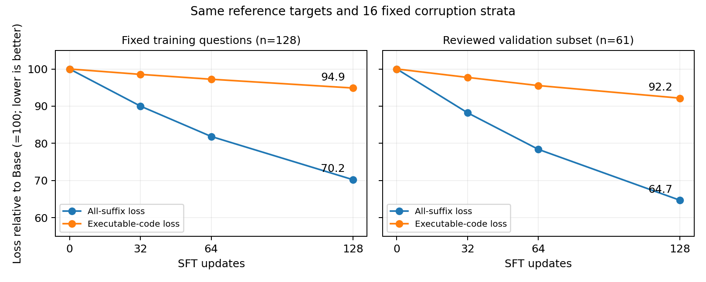

# 最新SFT对照、学习曲线与代码loss诊断

本页补齐此前公开版之后的实验。全部使用约168M参数同一Base，核心结果仍是：固定ReMDM回改有推理收益，尚未找到稳定的额外SFT收益。

## 1. 固定采样下检查训练增益

先前GSM512低学习率step64在dev384做完整2×2对照：

| 模型与采样 | seed42 | seed123 | 平均正确率 |
| --- | ---: | ---: | ---: |
| Base＋原采样 | 146 | 142 | 37.50% |
| 旧SFT＋原采样 | 141 | 136 | 36.07% |
| Base＋固定ReMDM | 160 | 151 | 40.49% |
| 旧SFT＋固定ReMDM | 156 | 149 | 39.71% |

回改对该SFT也有效（+3.65个百分点），但同回改下SFT相对Base−0.78个百分点、95%配对区间[−2.86,+1.30]；没有额外训练收益证据。不能把SFT＋回改超过原采样Base算作SFT收益。

随后在相同128条审阅参考程序上，主干lr2e-6、effective16/micro4、warmup4、32次更新（4遍）、训练seed42，从Base分别训练匹配普通SFT、联合错误上下文/位置评分头SFT，以及LIFT-3适配。主干全参数更新，评估最终step32。

| 方法 | dev384 seed42 | seed123 | 平均正确率 |
| --- | ---: | ---: | ---: |
| Base＋固定ReMDM | 160 | 151 | 40.49% |
| 普通SFT＋固定ReMDM | 159 | 154 | 40.76% |
| 联合SFT＋固定ReMDM | 160 | 153 | 40.76% |
| 联合SFT＋学习评分回改 | 148 | 142 | 37.76% |
| LIFT SFT＋固定ReMDM | 160 | 150 | 40.36% |

联合组50%普通输入、50%错误上下文输入，加入位置BCE；小型位置头98,561参数。人工单token运算符扰动不代表真实错误分布。固定采样下与普通组差值0.00个百分点、区间[−0.91,+0.91]；同联合模型改用学习评分回改后−2.99个百分点、区间[−5.08,−0.91]。改值次数更多不等于修复更多错误。

LIFT先用无梯度前向估计参考token概率，再按遮盖阶段选困难/随机/容易位置回填监督；适配官方LIFT-3，不是新评分头。对Base−0.13个百分点、区间[−1.56,+1.30]，对普通组−0.39、区间[−1.56,+0.78]。LIFT多一次无梯度前向，等更新数不等于等训练算力。

单一配方的阴性结果不能否定论文完整方法或全部SFT。dev已重复使用；所有区间按题保留两个生成种子，未覆盖多训练种子波动或校正反复选型。

## 2. 普通SFT继续到64/128步

从上述普通组的完整step32状态恢复，沿同一优化器与学习率轨迹继续到step128；lr2e-6，原生遮盖目标，固定ReMDM生成。最初重跑轨迹校验因小幅梯度范数差异停止，随后通过核对旧step32状态恢复；没有声称重新跑出的轨迹逐位相同。

| 累计更新 | 数据遍数 | 训练128题均值 | dev384均值 |
| --- | ---: | ---: | ---: |
| Base | 0 | 63.28% | 40.49% |
| 32 | 4 | 64.06% | 40.76% |
| 64 | 8 | 64.84% | 40.36% |
| 128 | 16 | 66.41% | 39.84% |

128步相对Base，训练题+3.12个百分点、区间[−0.78,+7.03]；dev−0.65、区间[−2.73,+1.43]。训练题点估计上升但区间跨0，dev没有同步收益；不能仅凭曲线确诊过拟合。

## 3. 最新诊断：训练与验证代码loss都下降

这次仅前向，不训练、不新增完整生成。原训练128题；先冻结dev前64题，Agent编写参考代码并检查算术/依赖/隔离执行，排除3个歧义或参考错误题且不补位，得到验证61题。参考程序在读取生成成绩前冻结；未写回训练。不是独立人工认证，也不是独立最终测试。

四个检查点使用eval模式、相同16组分层时间/遮盖条件，代码区域排除题目复述docstring、注释、纯空白、EOS/PAD。代码loss采用原MDLM的1/t加权，分母为该区域所有可监督token。

| 检查点 | 训练总loss | 训练代码loss | 验证总loss | 验证代码loss | 同61验证题生成均值 |
| --- | ---: | ---: | ---: | ---: | ---: |
| Base | 0.392700 | 1.136295 | 0.365134 | 0.556284 | 45.90% |
| 32 | 0.353518 | 1.119849 | 0.322112 | 0.543694 | 47.54% |
| 64 | 0.321434 | 1.104991 | 0.286194 | 0.531476 | 45.08% |
| 128 | 0.275836 | 1.078217 | 0.236216 | 0.512672 | 44.26% |

Base→128步，训练代码loss下降5.11%、验证下降7.84%；配对变化区间分别[−0.063974,−0.052483]与[−0.053581,−0.034437]，均低于0。这说明参考代码补全改善并不限于训练题，本诊断没有出现验证代码loss上升。

同61题生成从45.90%到44.26%，差−1.64个百分点、区间[−6.56,+3.28]，既无收益证据，也未证明显著退化。61题是dev子集，不可拿其绝对分数替代dev384。

总loss减少量中，docstring贡献训练侧93.54%、验证侧96.01%；可执行代码贡献5.82%、3.26%；PAD贡献0.12%、0.22%。这是损失值分解，不是梯度归因，更不是“删除docstring一定提分”的证据；已有取消docstring损失消融没有稳定收益。

更准确的结论是：**固定参考代码和遮盖上下文下的补全能力提高，尚未转化为完整生成任务收益。** 单参考程序不覆盖所有正确解法，部分正确上下文也不同于从全MASK生成并继承自身错误；这些是解释边界，不是唯一根因证明。

总loss与代码loss分母不同；训练与验证参考程序风格也不同。比较各集合内部的变化，不用训练/验证绝对loss高低给难度或泛化排名。

3072次主干前向、12096条逐题遮盖记录与分区损失加总检查通过；模型与原数据哈希未变。无新增训练、生成或模型文件。诊断约1.48分钟。

详见[完整loss报告](CODE-VAL-LOSS.zh-CN.md)。

曲线以各自Base归一化为100。现阶段继续保留Base＋固定ReMDM为参照，不仅凭loss下降继续加训练步数。
